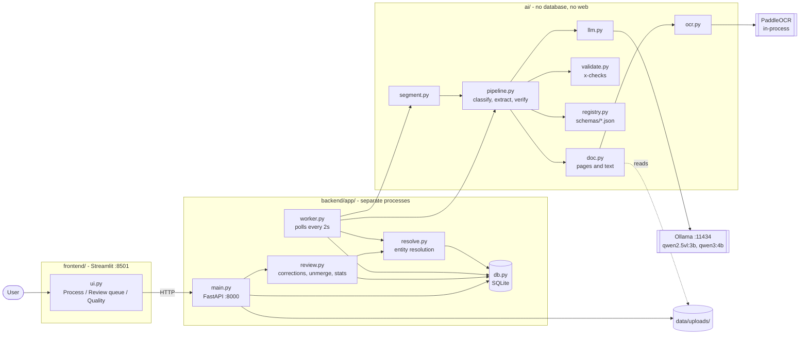
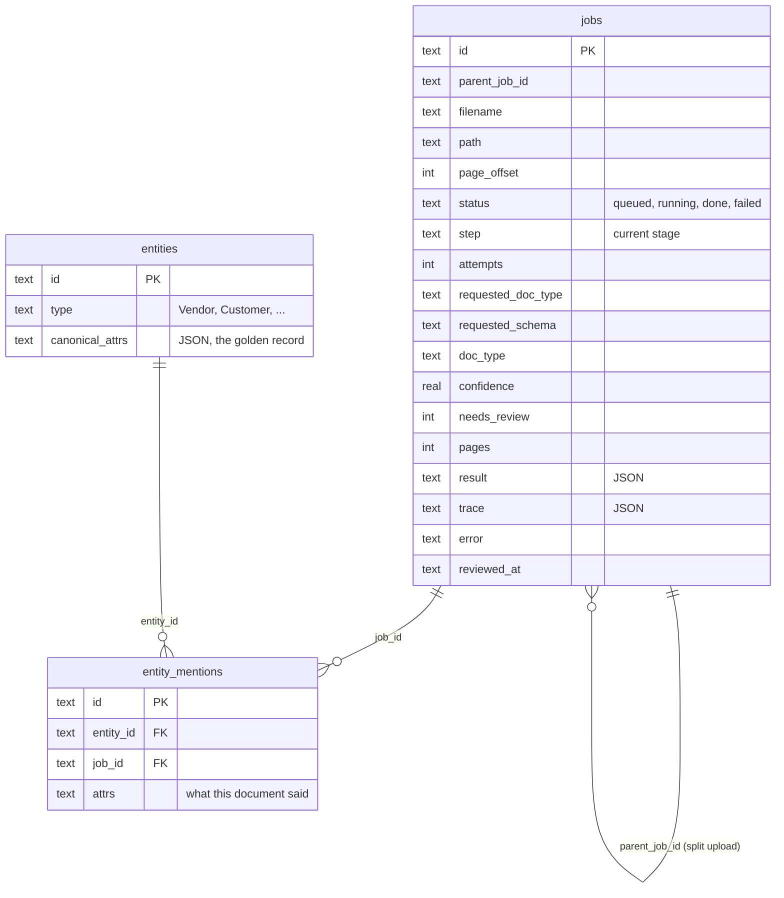
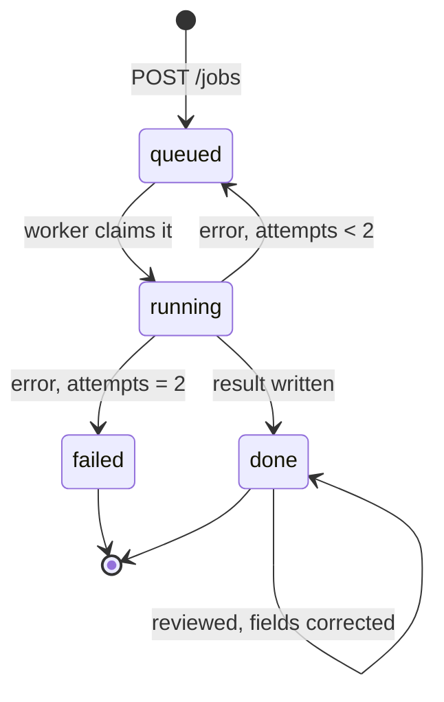

# Architecture

How the pieces fit together and where each one lives. For what happens to a
document, read [solution-flow.md](solution-flow.md).

## System diagram

Everything runs on one machine. Nothing leaves it: models are served by Ollama
and OCR runs in-process.

Three processes: the **UI**, the **API** and the **worker**. The API only
accepts uploads and reports status. The worker does the slow work, so a job
survives an API restart, and the UI needs none of the heavy dependencies.

## Dependency rule

`backend` may import `ai`. `ai` must never import `backend`. That keeps
`ai/pipeline.py` a plain function of `(pages, schema)`, with no job id and no
database, so the CLI (`python -m ai.pipeline file.pdf`) and every test call it
directly. Entity resolution is in the backend for the same reason.

## Module map

| Path | Role |
|---|---|
| `ai/doc.py` | Open a PDF or image, render each page to PNG, read the text layer, fall back to OCR. Refuses documents over 10 pages. |
| `ai/ocr.py` | PaddleOCR singleton, loaded lazily on first use. |
| `ai/llm.py` | The only module that knows about Ollama. Passes a JSON Schema as `format` so decoding is constrained. |
| `ai/pipeline.py` | `classify`, `extract`, `verify`, plus value coercion. `run` and `run_pages` are the entry points. |
| `ai/segment.py` | Splits a multi-document upload into one group of pages per document. |
| `ai/validate.py` | Runs a schema's `x-checks` rules against the extracted values. |
| `ai/registry.py` | Schema registry and the check applied to user-supplied schemas. |
| `ai/schemas/*.json` | One JSON Schema per document type. The filename is the type. |
| `backend/app/main.py` | HTTP endpoints, upload handling. |
| `backend/app/worker.py` | Claims queued jobs, runs the pipeline, retries, rolls up multi-document uploads. |
| `backend/app/db.py` | SQLite access, no ORM. |
| `backend/app/resolve.py` | Matches extracted entities to golden records. |
| `backend/app/review.py` | Applies reviewer corrections, unmerges entities, computes quality stats. |
| `frontend/ui.py` | Streamlit UI with the neobrutalist theme in `frontend/.streamlit/`. |
| `scripts/` | `backend.sh`, `frontend.sh`, `eval.py`. |
| `tests/test_pipeline.py` | Offline tests plus live tests that skip when Ollama is down. |

## Data model

SQLite file at `data/idp.db`; uploaded files in `data/uploads/`.

- A **job** is one upload, or one sub-document of a split upload (a child points
  at its parent with `parent_job_id`, and `page_offset` says where its pages start).
- `result` holds the fields, per-field confidence, validation outcome and
  timings. `trace` is the full agent log: every call, correction and review edit.
- An **entity** is a golden record. Each **mention** keeps what one document
  actually said, so a record can be rebuilt after a correction or an unmerge.

## Job lifecycle

`step` carries the stage name while a job is `running` (reading, classifying,
extracting, verifying, validating, resolving). The UI's stage tracker and
per-stage timings come from it. A failed job keeps the stage that failed.

## API

| Endpoint | Purpose |
|---|---|
| `POST /jobs`, `POST /jobs/batch` | Upload one or many files. Returns job ids, status `queued`. |
| `GET /jobs`, `GET /jobs/{id}` | List jobs; one job with fields, confidence, trace and children. |
| `GET /jobs/{id}/pages/{n}` | Rendered page PNG for the preview. |
| `GET /review`, `POST /jobs/{id}/review` | Flagged jobs; apply corrections or mark "checked". |
| `POST /jobs/{id}/entities/{type}/unmerge` | Split a job off a golden record it was wrongly matched to. |
| `GET /stats` | Review rate, confidence, entity match rate, what reviewers corrected. |
| `GET /schemas`, `GET /schemas/{type}` | The schema registry. |
| `GET /health` | Ollama reachable, models present. |

## Design choices

| Choice | Why |
|---|---|
| JSON Schema as the decoding constraint | Ollama restricts generation to it, so no output parser or repair loop. `$ref`, `oneOf`, `allOf`, `anyOf` are rejected at upload because constrained decoding mishandles them. |
| Text layer and image together | Digital PDFs carry exact text, so the model copies it rather than reading pixels. Scans fall back to OCR text, labelled "may contain errors". |
| Separate worker process | A job survives API restarts and retries. One worker runs one document at a time, which is all a 3B model on 16 GB can do. |
| SQLite, no ORM | One user, one machine. Columns are added with `ALTER TABLE` on start-up. |
| Rules in the schema (`x-checks`) | A new document type brings its own arithmetic checks with no Python change. |
| Entity hints in the schema (`x-entity`) | The same way: a new type declares which fields identify a vendor, customer or account. |
| Plain-string entity matching | Stdlib `difflib` over a same-first-word block is instant at a few thousand entities per type. |

## Not built

A layout model, vector database, Docker, Celery or Redis, auth, and a knowledge
graph (entity-to-entity edges). The README backlog says when each becomes worth
building.
