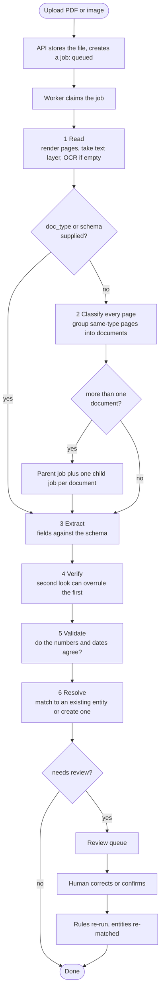
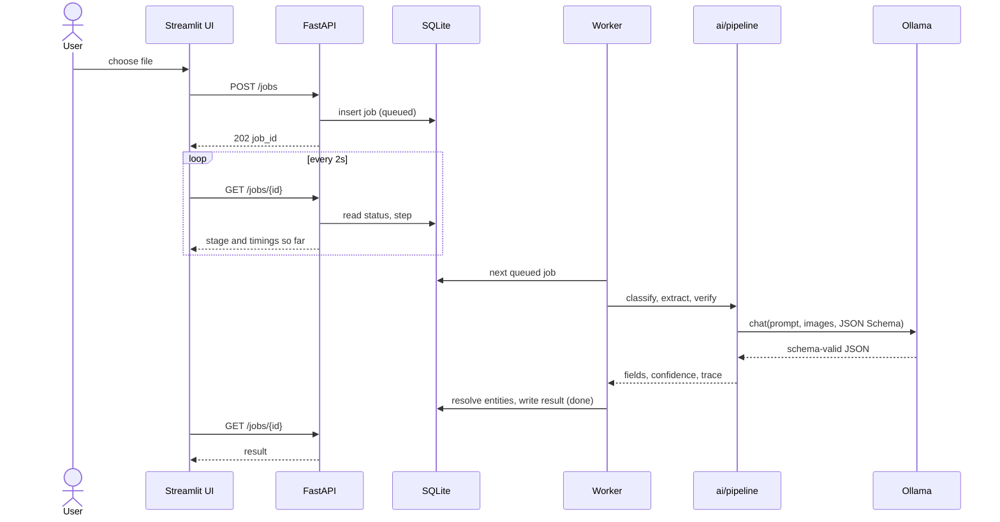
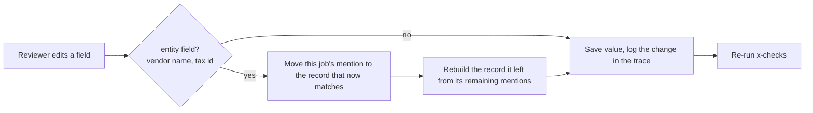

# Solution flow

What happens to a document, from upload to a reviewed record. For how the code
is organised, read [architecture.md](architecture.md).

## End to end

## Stages

| # | Stage | What it does | Model | Typical time |
|---|---|---|---|---|
| 1 | Read | Renders pages at 150 dpi (longest edge 1400 px). Uses the PDF text layer; runs PaddleOCR on a page that has none. Refuses more than 10 pages. | none (PaddleOCR) | seconds |
| 2 | Classify | One call per page. A page with 200+ characters of text goes to the text-only model; a sparse page goes to the vision model. Types come from the schema filenames plus `unknown`. | `qwen3:4b` or `qwen2.5vl:3b` | ~45 s vision |
| 3 | Extract | Asks for the schema's fields with constrained decoding, 4 pages per call, merging chunks. Unknown types use the generic schema. | `qwen2.5vl:3b` | ~60 s |
| 4 | Verify | Re-reads every page (4 per call) with the answers in hand and is told to find mistakes. A field passes if any chunk confirms it. Corrections are applied and checked once more. Only scalar fields are verified. | `qwen2.5vl:3b` | ~85 s |
| 4b | Signals | Caps a field's confidence at 0.4 if the verifier overruled it or the value is not on the page (`ai/ground.py`). | none | instant |
| 5 | Validate | Runs the schema's `x-checks` on the corrected values. | none | instant |
| 6 | Resolve | Folds `x-entity` fields into golden records. | none | instant |

Times are from an M2 with 16 GB, for a one-page invoice. Jobs run one at a time.

## Sequence

## What gets flagged for review

A job is sent to the review queue when any of these holds:

- a field's confidence is below 0.6 after verification. A field is capped at 0.4
  when the verifier overruled the first extraction (`verifier_overruled`) or its
  value is in none of the page text (`not_on_page`), whatever the verifier claimed
- the document type was classified with confidence below 0.6
- an `x-checks` rule failed, **even when the model was confident**

A rule with a missing value is skipped, not failed, and a rule that does not
parse is skipped too. A typo in your own schema cannot fail a job.

## Review and entities

- Corrections change the job's values. The model's own confidence is left alone,
  because the quality dashboard measures it.
- **Entity matching:** a strong identifier (tax id, account number) match wins
  whatever the name says. Otherwise names are compared after dropping legal
  suffixes (Ltd, GmbH, Inc) and a similarity of 0.85 or more joins the record.
- **Unmerge** splits a job off a record it was wrongly matched to. Two jobs
  unmerged from one record become two separate records; there is no merge yet.

## Extending

| To do this | Do this |
|---|---|
| Add a document type | Drop a JSON Schema in `ai/schemas/`. The filename becomes a classifier label and an extraction target. |
| Add a consistency rule | Add a string to the schema's `x-checks`: `a + b = c`, `sum(rows.col) = x`, `d1 <= d2`. |
| Link a field to an entity | Add `"x-entity": {"type": "Vendor", "key": "primary_name", "strong": false}` to the property. Malformed hints are rejected at upload. |
| Use your own schema for one job | POST it as the `schema` form field. |
| Swap a model | Set `IDP_EXTRACT_MODEL`, `IDP_CLASSIFY_MODEL` or `IDP_TEXT_CLASSIFY_MODEL`. |
| Move off Ollama | Rewrite `ai/llm.py`; nothing else knows about the provider. |
| Measure accuracy | `scripts/eval.py` against SROIE, CORD or your own labelled folder. |

## Known limits

- A 3B vision model is mediocre on dense or low-quality scans.
- Two same-type documents with no "Page 1 of N" marker stay merged.
- Documents over 10 pages are refused.
- A worker crash can strand a job at `running`; there is no lease or heartbeat.
- No bounding boxes: a value is not tied to where it appeared on the page.
- Field confidence still starts from the verifier's own report, a weak signal, and
  is only capped by the two warning signs. `scripts/eval.py` shows how well each
  sign separates right values from wrong ones.
